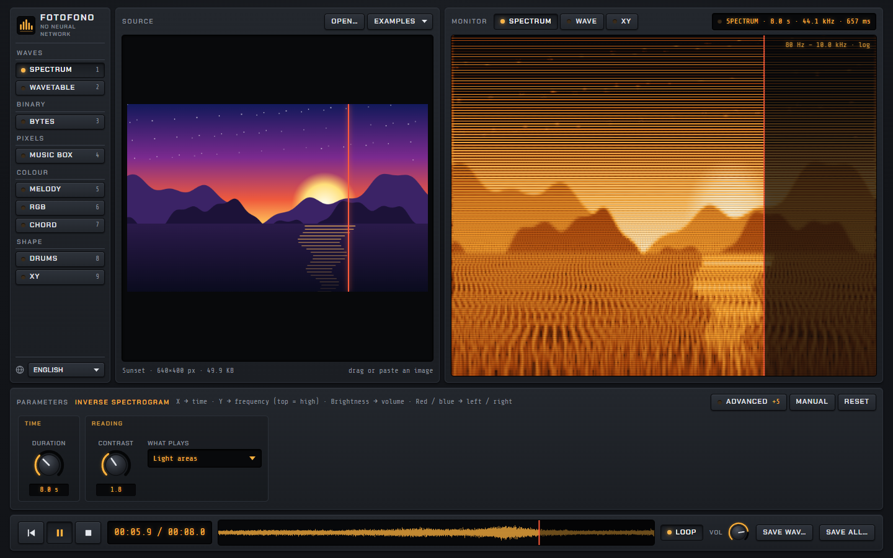
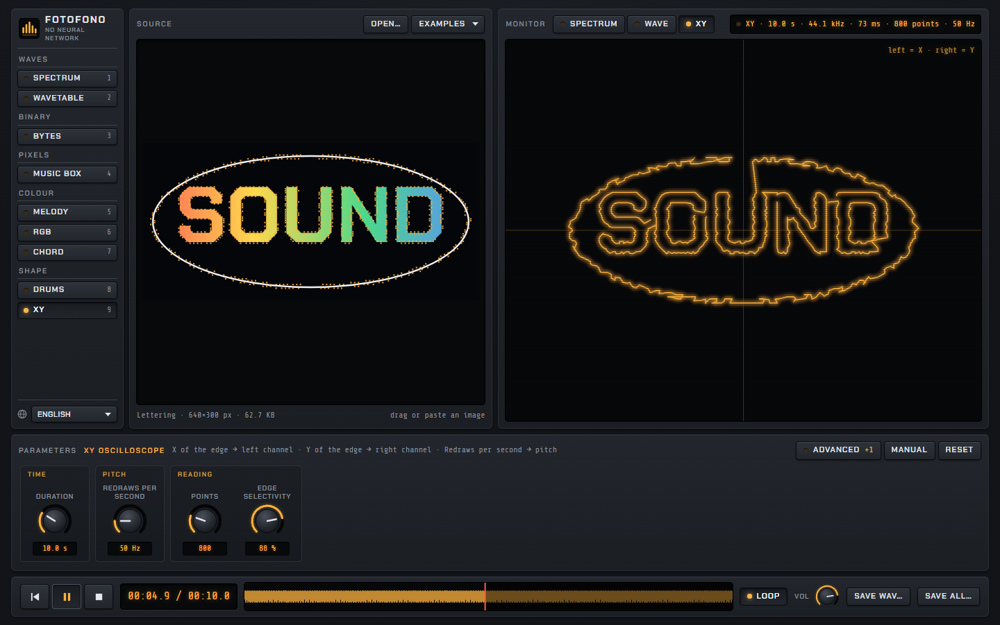
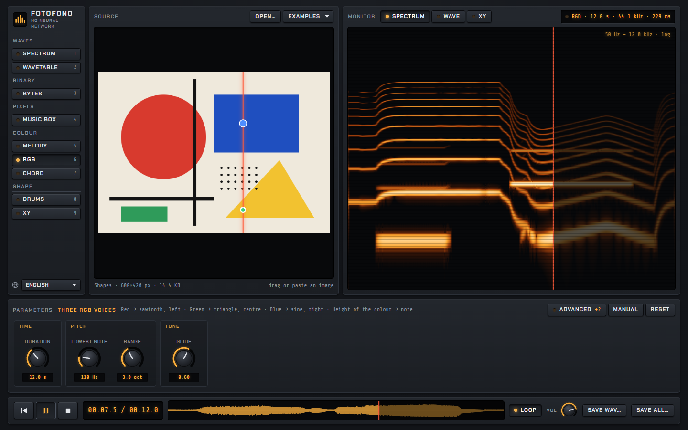

<p align="center"></p>

<h1 align="center">Fotofono</h1>

<p align="center"><b>Turn any image into sound — with rules you can read, not a neural network.</b><br>
English · Italiano · Español · Français · Deutsch · Português</p>



Fotofono reads an image in nine different, fully deterministic ways and turns each one into stereo audio. Every pixel has a consequence you can trace: the same image always gives the same sound, and the manual inside the app tells you exactly which property of the image drives which property of the sound.

It runs as a **Windows app** (one portable `.exe`, nothing to install) or as a **single web page** you can open in any modern browser.

## The nine modes

| Mode | Family | How the image becomes sound |
|---|---|---|
| **Inverse spectrogram** | Waves | The image is read as a spectrogram: each row is a sine oscillator, brightness is its volume. On the Spectrum screen the image reappears. |
| **Wavetable** | Waves | Each row's brightness profile is one cycle of a waveform; the sound morphs from row to row. |
| **Bytes as samples** | Binary | The raw pixel bytes (or the compressed file itself) become the audio samples, in a reading order you choose (rows, serpentine, spiral, Hilbert curve…). |
| **Grid music box** | Pixels | Columns are steps, rows are scale degrees. The cells that differ from the background play — a drawing on white paper plays its lines, not the paper. |
| **Colour melody** | Colour | Hue picks the scale degree, lightness the octave; colourless areas play by brightness; background cells are rests. |
| **Three RGB voices** | Colour | Red, green and blue each follow the centre of their strongest band, as three melodies in three stereo positions. |
| **Colour chord** | Colour | The 12 hue sectors map to the 12 semitones; the most present colours form a sustained chord. |
| **Drums from edges** | Shape | A Sobel filter finds edges: top band → hi-hat, middle → snare, bottom → kick. Column colour picks the bass note. |
| **XY oscilloscope** | Shape | The edges become a stereo signal (left = X, right = Y) that redraws the image on the XY screen. |

<p align="center">
  
  
</p>

## Download and use

**Windows:** download `Fotofono.exe` from the [latest release](../../releases/latest) and double-click it. Nothing to install: it's a single portable file. It needs Microsoft Edge WebView2, which is already part of Windows 11 (on older systems the app offers the download link).

**Any system:** open [`docs/index.html`](docs/index.html) in a modern browser.

- Drag, paste (Ctrl+V) or open (Ctrl+O) an image, or start from the built-in examples.
- Pick a mode with the buttons on the left or the keys **1–9**; **Space** plays and pauses.
- Turn the knobs: drag up or down, use the mouse wheel or the arrow keys; double-click resets a knob. The essential controls are always visible; **Advanced** shows the rest.
- **Save WAV** (Ctrl+S) saves the current mode; **Save all** (Ctrl+Shift+S) saves all nine modes as a zip.
- On Windows you can also drag an image onto `Fotofono.exe`, or use *Open with → Fotofono*.

The interface follows your system language and can be changed from the menu at the bottom left.

## Languages

English, Italiano, Español, Français, Deutsch, Português.

To add a language, copy the `en` block of the `I18N` object in `docs/index.html`, translate the values and give it the two-letter language code. Missing keys fall back to English. For the Windows dialogs, add the same code to `windows/Strings.cs`.

## Build the Windows app

Requirements: Windows and the [.NET 8 SDK](https://dotnet.microsoft.com/download/dotnet/8.0).

```bash
cd windows
dotnet publish -c Release -o ../build
```

The result is `build/Fotofono.exe` (self-contained, about 70 MB). The app embeds `docs/index.html`, so web and desktop always share the same code.

## How it is made

- `docs/index.html` — the whole instrument: image analysis, the nine synthesis engines, the interface and the translations, in plain HTML, CSS and JavaScript with no dependencies. Audio is computed sample by sample and played with the Web Audio API.
- `windows/` — a small C# / WinForms shell around [WebView2](https://learn.microsoft.com/microsoft-edge/webview2/) that adds the native *Save as* dialog, *Open with*, offline fonts and a remembered window position.

## Credits

Fonts: [Chakra Petch](https://github.com/m4rc1e/Chakra-Petch), [Share Tech Mono](https://fonts.google.com/specimen/Share+Tech+Mono) and [IBM Plex Sans](https://github.com/IBM/plex), all under the SIL Open Font License 1.1 (see `windows/fonts/`).

## License

[MIT](LICENSE) © 2026 RidiConClaudio

---

### Italiano

**Fotofono trasforma qualsiasi immagine in suono con regole leggibili, senza reti neurali.** Legge l'immagine in nove modi deterministici (spettrogramma, byte grezzi, carillon, colori, wavetable, contorni, oscilloscopio XY…) e ne ricava audio stereo. Per Windows basta scaricare `Fotofono.exe` dall'[ultima release](../../releases/latest) e aprirlo; in alternativa si apre `docs/index.html` in un browser. L'interfaccia segue la lingua del sistema e si cambia dal menu in basso a sinistra.
